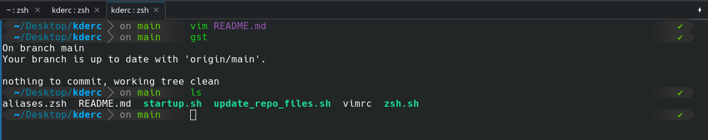
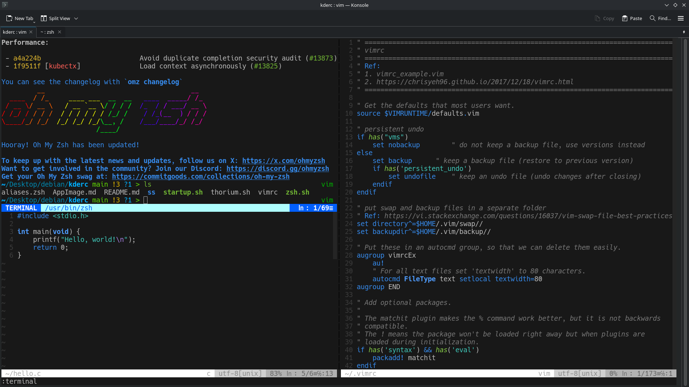
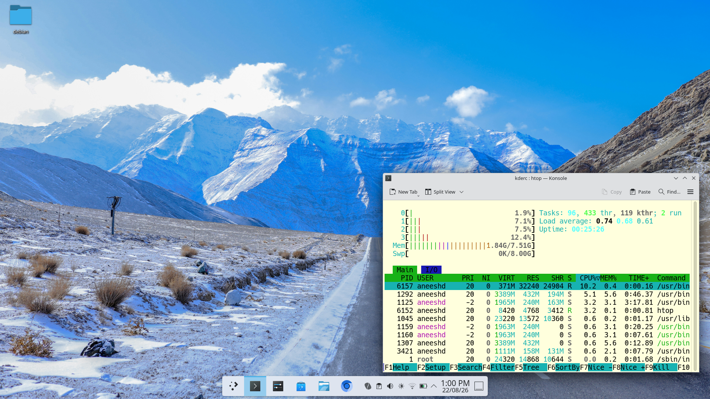

# kderc

A hodgepodge of quick KDE UI fixes and application prefs.
Here's a jumbled assortment of fixes and tweaks made to my desktop environment.
> NOTE: Intended to be modified with future changes; current files may/not work on all DEs.


## Shell UI
zsh UI/UX


```sh
./zsh.sh
cp aliases.zsh "${ZSH_CUSTOM:-$HOME/.oh-my-zsh/custom}/aliases.zsh"
```

## Vim UI


```sh
cp vimrc ~/.vimrc
source ~/.vimrc
```

## Light / Dark Mode
Match your desktop to the time of day.

| Light Mode | Dark Mode |
|:----------:|:---------:|
|  |  |

> Ref: Koi - https://github.com/baduhai/Koi

## Thorium Browser
The browser's really fast for everyday operations.

```sh
./thorium.sh
```

## AppImage -> Desktop Application
Download AppImages and convert them to desktop applications.

Ref: [AppImage.md](AppImage.md)

---
> This repo is implemented in KDE, but the ideas are simple enough to carry over to GNOME, XFCE, and other Linux desktops.

